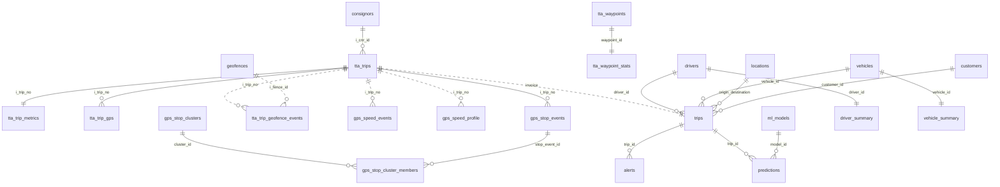

# smart_truck database schema

Reference for the existing `smart_truck` MySQL 8 database (InnoDB, local `:3306`). It belongs to another system and our services only read it (see `SmartTruckGpsReader`). Generated from `information_schema` plus row counts and column fill rates on 2026-10-31; re-run the generator after the source changes.

**43 tables, 531 columns, 125 indexes, 23 foreign keys, 7,916,409 rows.** No views, triggers, stored procedures or scheduled events. Almost no column comments (6 of 531).

One consignor (TATA STEEL-JSR, id 540). Trips 13 Jul - 15 Oct 2026, GPS pings 10 Jul - 15 Oct 2026.

## Naming convention

The TTA tables use Hungarian-style prefixes taken from the source API: `i_` integer, `d_` decimal, `s_` string, `dt_` datetime, `c_` single-letter code, `b_`/`is_` flag, `j_` JSON. The legacy and summary tables use plain snake_case (`trip_start`, `driver_id`). The trip key is `i_trip_no` (bigint) in TTA tables and `id` (int) in the legacy `trips` table; the two are joined by `trips.invoice_no = tta_trips.s_invoice`.

## How the tables connect

Solid lines are declared foreign keys. Dotted lines are joins the data supports but the database does not enforce.

## Tables at a glance

| Group | Table | Rows | Size MB | What it holds |
|---|---|--:|--:|---|
| Trips from the TTA feed (main source) | [`tta_trips`](#tta_trips) | 7,908 | 7.7 | One row per trip from the Tata Steel TTA feed: consignor, origin/destination node, transporter, vehicle, driver, booking/start/ETA/ATA/end times, plus origin-geofence exit fields we derived. |
| Trips from the TTA feed (main source) | [`tta_trip_metrics`](#tta_trip_metrics) | 7,908 | 16.8 | One row per trip of TTA's own computed metrics: transit, detention, moving/stoppage time, plant VIVO, distance, speed violations, GPS uptime, invoice qty. |
| Trips from the TTA feed (main source) | [`tta_trip_gps`](#tta_trip_gps) | 7,078,721 | 2961.9 | Every GPS ping per trip: time, lat/long, speed, status text, nearest two waypoints with distance, cumulative distance. |
| Trips from the TTA feed (main source) | [`tta_trip_geofence_events`](#tta_trip_geofence_events) | 16,873 | 8.1 | Enter/exit events of each trip against the geofences table, with gap minutes. |
| Trips from the TTA feed (main source) | [`tta_waypoints`](#tta_waypoints) | 4,461 | 0.6 | Named roadside waypoints (village/town names) seen in the GPS feed's s_wpnt1/s_wpnt2, with state and position. |
| Trips from the TTA feed (main source) | [`tta_waypoint_stats`](#tta_waypoint_stats) | 4,461 | 1.6 | Per waypoint: trips, vehicles, pings, moving/stopped minutes, stop events, and hour-of-day / weekday profiles (JSON). |
| Places and geofences | [`geofences`](#geofences) | 87 | 0.0 | Circular fences: 1 origin (Tata Steel Jamshedpur, 10 km) and 86 destinations (1-20 km). |
| Places and geofences | [`gps_facility_anchors`](#gps_facility_anchors) | 127 | 0.0 | Learned centre point per origin/destination node name, from where trips actually start/end. |
| Places and geofences | [`locations`](#locations) | 144 | 0.0 | Legacy model: plain list of place names used by `trips`. |
| Derived GPS analytics | [`gps_stop_events`](#gps_stop_events) | 15,192 | 8.1 | Each stop a truck made (start, end, minutes, position, spread, ping gaps, nearest waypoint) and its place class: origin, destination, named_node or unclassified. |
| Derived GPS analytics | [`gps_stop_clusters`](#gps_stop_clusters) | 560 | 0.5 | Stops clustered into recurring places (dhabas, parking, gates): stop/trip/vehicle/carrier counts, median dwell, night share, score, amenity hint. |
| Derived GPS analytics | [`gps_stop_cluster_members`](#gps_stop_cluster_members) | 5,550 | 1.9 | Link table: which stop event belongs to which cluster. |
| Derived GPS analytics | [`gps_stop_extract_log`](#gps_stop_extract_log) | 1,348 | 0.1 | Bookkeeping: when stops were extracted for a trip and how many were found. |
| Derived GPS analytics | [`gps_speed_events`](#gps_speed_events) | 28,226 | 7.1 | Over-speed episodes: zone (plant 10 km/h floor, road 40 km/h floor), peak and average speed, minutes, distance, position. |
| Derived GPS analytics | [`gps_speed_profile`](#gps_speed_profile) | 581,815 | 107.3 | Per trip x zone x hour x speed bucket: pings, minutes, metres. |
| Derived GPS analytics | [`gps_speed_build`](#gps_speed_build) | 2 | 0.0 | Bookkeeping for the speed-profile build job. |
| Derived GPS analytics | [`gps_grid_agg`](#gps_grid_agg) | 65,652 | 5.5 | Ping weight per 0.01 degree grid cell (moving/stopped), for heatmaps. |
| Derived GPS analytics | [`gps_waypoint_agg`](#gps_waypoint_agg) | 8,922 | 3.0 | Per waypoint: trips, vehicles, pings, moving/stopped hours. |
| Derived GPS analytics | [`gps_waypoint_hour_agg`](#gps_waypoint_hour_agg) | 68,738 | 8.5 | Per waypoint x hour: stopped minutes. |
| Derived GPS analytics | [`gps_state_agg`](#gps_state_agg) | 46 | 0.0 | Per Indian state: trips, vehicles, pings, moving/stopped hours. |
| Derived GPS analytics | [`gps_network_kpi`](#gps_network_kpi) | 2 | 0.0 | Network totals per consignor: waypoints, states, trips, vehicles, pings. |
| Derived GPS analytics | [`gps_hotspot_labels`](#gps_hotspot_labels) | 2 | 0.0 | Manual labels a person put on map hotspots. |
| Legacy relational model (older app) | [`trips`](#trips) | 7,908 | 3.6 | Older normalised copy of every trip (same 7,908 trips, joined to tta_trips by invoice_no = s_invoice) with integer FKs to drivers, vehicles, locations, customers. |
| Legacy relational model (older app) | [`drivers`](#drivers) | 1,835 | 0.2 | Driver name and up to two mobile numbers. |
| Legacy relational model (older app) | [`vehicles`](#vehicles) | 1,776 | 0.2 | Vehicle asset id (registration), asset type, trailer type. |
| Legacy relational model (older app) | [`customers`](#customers) | 214 | 0.0 | Consignees (delivery customers). |
| Legacy relational model (older app) | [`consignors`](#consignors) | 1 | 0.0 | The shipper. |
| Legacy relational model (older app) | [`waypoints`](#waypoints) | 0 | 0.1 | Legacy per-trip GPS table. |
| Summaries for dashboards | [`driver_summary`](#driver_summary) | 3,180 | 1.5 | Per driver: trips, ETA success, durations, speed, distance, vehicles used. |
| Summaries for dashboards | [`vehicle_summary`](#vehicle_summary) | 2,818 | 0.4 | Per vehicle: trips, drivers used, speed, distance, ETA success. |
| Summaries for dashboards | [`customer_summary`](#customer_summary) | 0 | 0.0 | Per customer roll-up. |
| Summaries for dashboards | [`route_summary`](#route_summary) | 220 | 0.1 | Per origin-destination: trip count, average duration, speed, distance, ETA success. |
| Summaries for dashboards | [`route_time_patterns`](#route_time_patterns) | 871 | 0.2 | Per route x hour x weekday: average duration, trip count, ETA success. |
| Summaries for dashboards | [`daily_fleet_stats`](#daily_fleet_stats) | 62 | 0.0 | Per day: trips, distance, average speed, ETA success, active drivers and vehicles. |
| ML and alerts (earlier attempts) | [`ml_models`](#ml_models) | 8 | 0.0 | Registry of trained models with metrics, features, hyperparameters, training window and validation verdict. |
| ML and alerts (earlier attempts) | [`predictions`](#predictions) | 22 | 0.1 | Model outputs with inputs, confidence and later actual value. |
| ML and alerts (earlier attempts) | [`alerts`](#alerts) | 101 | 0.1 | Generated alerts (anomaly, fatigue) with severity and read/acknowledged flags. |
| ML and alerts (earlier attempts) | [`tta_plant_delay_cache`](#tta_plant_delay_cache) | 18 | 0.3 | Cached plant-delay analysis per trip (JSON), with the insight text and the model that wrote it. |
| Sync, settings and housekeeping | [`tta_sync_runs`](#tta_sync_runs) | 428 | 0.1 | Each pull from the TTA API: lane (local/zonal), window, trips upserted, GPS inserted/skipped/failed, errors, duration. |
| Sync, settings and housekeeping | [`tta_data_gaps`](#tta_data_gaps) | 4 | 0.0 | Detected holes in the feed (lane, start, end, hours, state). |
| Sync, settings and housekeeping | [`app_settings`](#app_settings) | 7 | 0.0 | Key/value JSON settings: sync config per lane, last-synced marks, and a cost model (driver wage/hour, fuel km per litre, fuel price, idle litres/hour). |
| Sync, settings and housekeeping | [`file_uploads`](#file_uploads) | 10 | 0.0 | Uploaded TTA JSON files and their processing status. |
| Sync, settings and housekeeping | [`tta_weather_cache`](#tta_weather_cache) | 181 | 0.5 | Cached weather API answers by place and date. |

## Things to know before using the data

- **`tta_trips.dt_trip_eta` is padded.** Trucks arrive on average about 31 hours before it; only 3% arrive after it. Any on-time flag built on it (`trips.eta_met`, the `eta_success_rate` columns in every summary table) is close to always true.
- **Two fleets.** July trips are all zonal (long-haul); September-October are about 90% local; August is nearly empty. `tta_trip_metrics` detention, stoppage and invoice qty are filled only for zonal trips (2,353 of 7,908).
- **Feed gaps.** `tta_data_gaps` holds two open holes (19-27 Sep, 29 Sep - 14 Oct). Leave trips in those windows out of training or trend charts.
- **Zero plant waits are data entry.** About a third of trips have booking time = start time because the booking was typed in at the gate (one transporter does this 99% of the time).
- **No fuel, maintenance, cost or engine data.** `trips.fuel_consumed`, `load_weight_kg` and `weather_conditions` exist but are empty. The only cost figures are the constants in `app_settings.cost_model` (driver Rs 150/hour, 4 km/l, Rs 100/l, idle 1.5 l/hour).
- **Driver names are free text** and filled on 57% of TTA trips; placeholders such as `0` and `TGFTU` appear.
- **`information_schema` row counts are estimates** (it reported 7,352 trips; the exact count is 7,908). The counts in this document are exact.
- **Two copies of each trip.** `tta_trips` is the one the sync keeps current; `trips` is the older normalised copy the same sync also writes (`tta_sync_runs.legacy_trips_synced`). Prefer the TTA tables.
- **GPS ping uniqueness** is enforced by `uq_gps_ping (i_trip_no, s_device_id, dt_message)`, so re-syncs do not duplicate pings.

## Table details

Fill = share of rows where the column has a value (text columns must also be non-empty). Key: PK primary key, UNI unique, MUL indexed. FK shows the referenced column.

### Trips from the TTA feed (main source)

#### tta_trips

One row per trip from the Tata Steel TTA feed: consignor, origin/destination node, transporter, vehicle, driver, booking/start/ETA/ATA/end times, plus origin-geofence exit fields we derived.

Rows: **7,908** · Size: 7.7 MB · Referenced by: `gps_stop_events.i_trip_no`, `tta_trip_gps.i_trip_no`, `tta_trip_metrics.i_trip_no`

| # | Column | Type | Null | Key | Fill | Default / extra | FK |
|--:|---|---|---|---|--:|---|---|
| 1 | `i_trip_no` | bigint | no | PRI | 100% |  |  |
| 2 | `i_cnr_id` | int | yes | MUL | 100% |  | `consignors.i_cnr_id` |
| 3 | `s_trip_class` | varchar(10) | no | MUL | 100% | default `zonal` |  |
| 4 | `s_cnr_name` | varchar(255) | yes |  | 100% |  |  |
| 5 | `s_asset_id` | varchar(50) | yes | MUL | 100% |  |  |
| 6 | `s_device_id` | varchar(50) | yes | MUL | 99% |  |  |
| 7 | `s_asset_type` | varchar(100) | yes |  | 99% |  |  |
| 8 | `c_trip_type` | varchar(20) | yes |  | **empty** |  |  |
| 9 | `s_trip_type_desc` | varchar(100) | yes |  | 11% |  |  |
| 10 | `i_org_node_no` | int | yes |  | **empty** |  |  |
| 11 | `s_org_node_name` | varchar(255) | yes | MUL | 100% |  |  |
| 12 | `i_dest_node_no` | int | yes |  | **empty** |  |  |
| 13 | `s_dest_node_name` | varchar(255) | yes |  | 100% |  |  |
| 14 | `s_final_dest` | varchar(255) | yes |  | 2% |  |  |
| 15 | `s_load_plant` | varchar(255) | yes | MUL | 70% |  |  |
| 16 | `dt_booking` | datetime | yes |  | 100% |  |  |
| 17 | `dt_trip_start` | datetime | yes | MUL | 100% |  |  |
| 18 | `dt_trip_eta` | datetime | yes |  | 100% |  |  |
| 19 | `dt_trip_ata` | datetime | yes |  | 54% |  |  |
| 20 | `dt_trip_end` | datetime | yes |  | 31% |  |  |
| 21 | `i_trans_id` | varchar(50) | yes |  | 99% |  |  |
| 22 | `s_trans_name` | varchar(255) | yes |  | 100% |  |  |
| 23 | `s_cne_name` | varchar(255) | yes |  | 100% |  |  |
| 24 | `c_trip_status` | varchar(30) | yes | MUL | 100% |  |  |
| 25 | `s_close_reason` | varchar(255) | yes |  | 100% |  |  |
| 26 | `s_invoice` | varchar(100) | yes |  | 100% |  |  |
| 27 | `s_card_id` | varchar(50) | yes |  | 100% |  |  |
| 28 | `s_shipment_id` | varchar(100) | yes |  | 30% |  |  |
| 29 | `s_event_code` | varchar(50) | yes |  | 30% |  |  |
| 30 | `s_gate_entry_no` | varchar(100) | yes |  | **empty** |  |  |
| 31 | `s_driver_name` | varchar(255) | yes |  | 57% |  |  |
| 32 | `s_driver_mobile_no` | varchar(20) | yes |  | 56% |  |  |
| 33 | `i_route_id` | int | yes |  | 30% |  |  |
| 34 | `s_created_by` | varchar(100) | yes |  | **empty** |  |  |
| 35 | `dt_created` | datetime | yes |  | 100% | default `CURRENT_TIMESTAMP` DEFAULT_GENERATED |  |
| 36 | `s_modified_by` | varchar(100) | yes |  | **empty** |  |  |
| 37 | `dt_modified` | datetime | yes |  | 100% | default `CURRENT_TIMESTAMP` DEFAULT_GENERATED on update CURRENT_TIMESTAMP |  |
| 38 | `i_gps_ping_count` | int | no |  | 100% | default `0` |  |
| 39 | `dt_geofence_out` | datetime | yes | MUL | 10% |  |  |
| 40 | `i_geofence_out_gap_min` | int | yes |  | 10% |  |  |
| 41 | `s_geofence_out_status` | varchar(24) | yes |  | 31% |  |  |
| 42 | `i_works_detention_min` | int | yes | MUL | 100% | STORED GENERATED |  |
| 43 | `i_geofence_tail_min` | int | yes | MUL | 10% | STORED GENERATED |  |
| 44 | `i_origin_total_min` | int | yes |  | 10% | STORED GENERATED |  |

Indexes: `idx_trips_geofence_out` (dt_geofence_out); `idx_trips_geofence_tail` (i_geofence_tail_min); `idx_trips_works_detention` (i_works_detention_min); `idx_tta_trips_asset` (s_asset_id,dt_trip_start); `idx_tta_trips_class` (s_trip_class,dt_trip_start); `idx_tta_trips_cnr` (i_cnr_id); `idx_tta_trips_device` (s_device_id); `idx_tta_trips_load_plant` (s_load_plant); `idx_tta_trips_route` (s_org_node_name,s_dest_node_name); `idx_tta_trips_start` (dt_trip_start); `idx_tta_trips_status` (c_trip_status)

#### tta_trip_metrics

One row per trip of TTA's own computed metrics: transit, detention, moving/stoppage time, plant VIVO, distance, speed violations, GPS uptime, invoice qty. `raw_json` keeps the full source record.

Rows: **7,908** · Size: 16.8 MB

| # | Column | Type | Null | Key | Fill | Default / extra | FK |
|--:|---|---|---|---|--:|---|---|
| 1 | `i_trip_no` | bigint | no | PRI | 100% |  | `tta_trips.i_trip_no` |
| 2 | `i_sl_no` | int | yes |  | 30% |  |  |
| 3 | `s_tag` | varchar(20) | yes |  | 30% |  |  |
| 4 | `s_store_entry_no` | varchar(100) | yes |  | 30% |  |  |
| 5 | `dt_ata_out` | datetime | yes |  | 16% |  |  |
| 6 | `dt_delivery` | datetime | yes |  | 100% |  |  |
| 7 | `s_delivery_status` | varchar(50) | yes | MUL | 20% |  |  |
| 8 | `s_delivery_dur` | varchar(100) | yes |  | 20% |  |  |
| 9 | `i_delivery_delta_min` | int | yes |  | 20% |  |  |
| 10 | `s_transit_time` | varchar(50) | yes |  | 92% |  |  |
| 11 | `i_transit_time_min` | int | yes |  | 92% |  |  |
| 12 | `s_detention` | varchar(50) | yes |  | 30% |  |  |
| 13 | `i_detention_min` | int | yes |  | 30% |  |  |
| 14 | `s_total_moving_time` | varchar(50) | yes |  | 30% |  |  |
| 15 | `i_moving_time_min` | int | yes |  | 30% |  |  |
| 16 | `s_total_stoppage_time` | varchar(50) | yes |  | 30% |  |  |
| 17 | `i_stoppage_time_min` | int | yes |  | 30% |  |  |
| 18 | `s_plant_vivo` | varchar(50) | yes |  | 65% |  |  |
| 19 | `i_plant_vivo_min` | int | yes |  | 65% |  |  |
| 20 | `d_distance_travelled_km` | decimal(10,2) | yes |  | 20% |  |  |
| 21 | `i_speed_violation` | int | yes |  | 30% |  |  |
| 22 | `d_uptime_pct` | decimal(6,2) | yes |  | 20% |  |  |
| 23 | `s_service_provider` | varchar(100) | yes |  | 30% |  |  |
| 24 | `s_supplier_name` | varchar(255) | yes |  | 30% |  |  |
| 25 | `s_cne_contact_no` | varchar(30) | yes |  | **empty** |  |  |
| 26 | `i_cne_pin` | int | yes |  | 99% |  |  |
| 27 | `s_ship_to_address` | varchar(500) | yes |  | 69% |  |  |
| 28 | `i_geo_id` | int | yes |  | 61% |  |  |
| 29 | `d_inv_qty` | decimal(14,2) | yes |  | 30% |  |  |
| 30 | `s_material_desc` | varchar(500) | yes |  | **empty** |  |  |
| 31 | `s_asset_make` | varchar(100) | yes |  | <1% |  |  |
| 32 | `s_asset_model` | varchar(100) | yes |  | <1% |  |  |
| 33 | `s_close_remarks` | varchar(500) | yes |  | **empty** |  |  |
| 34 | `s_fo_no` | varchar(100) | yes |  | **empty** |  |  |
| 35 | `i_trip_seq` | int | yes |  | 30% |  |  |
| 36 | `s_tta_ex_nd` | varchar(100) | yes |  | **empty** |  |  |
| 37 | `s_det_ex_nd` | varchar(100) | yes |  | **empty** |  |  |
| 38 | `raw_json` | json | yes |  | 100% |  |  |
| 39 | `dt_created` | timestamp | yes |  | 100% | default `CURRENT_TIMESTAMP` DEFAULT_GENERATED |  |

Indexes: `idx_tta_metrics_delivery_status` (s_delivery_status)

#### tta_trip_gps

Every GPS ping per trip: time, lat/long, speed, status text, nearest two waypoints with distance, cumulative distance. About 1 ping a minute; 78% of pings are stationary.

Rows: **7,078,721** · Size: 2961.9 MB

| # | Column | Type | Null | Key | Fill | Default / extra | FK |
|--:|---|---|---|---|--:|---|---|
| 1 | `id` | bigint | no | PRI | 100% | auto_increment |  |
| 2 | `i_trip_no` | bigint | no | MUL | 100% |  | `tta_trips.i_trip_no` |
| 3 | `s_asset_id` | varchar(50) | yes | MUL | 100% |  |  |
| 4 | `s_device_id` | varchar(50) | yes |  | 100% |  |  |
| 5 | `i_entity_id` | int | yes |  | 100% |  |  |
| 6 | `s_entity_name` | varchar(255) | yes |  | 100% |  |  |
| 7 | `dt_message` | datetime | no | MUL | 100% |  |  |
| 8 | `d_lat` | decimal(10,8) | no |  | 100% |  |  |
| 9 | `d_long` | decimal(11,8) | no |  | 100% |  |  |
| 10 | `i_speed` | smallint | yes |  | 100% | default `0` |  |
| 11 | `s_wpnt1` | varchar(255) | yes | MUL | 100% |  |  |
| 12 | `i_wpnt1_mt` | int | yes |  | 100% |  |  |
| 13 | `s_wpnt1_st_abbr` | varchar(10) | yes |  | 100% |  |  |
| 14 | `s_wpnt2` | varchar(255) | yes |  | 100% |  |  |
| 15 | `i_wpnt2_mt` | int | yes |  | 100% |  |  |
| 16 | `s_wpnt2_st_abbr` | varchar(10) | yes |  | 100% |  |  |
| 17 | `s_uom` | char(2) | yes |  | 100% |  |  |
| 18 | `i_dist` | int | yes |  | 100% | default `0` |  |
| 19 | `i_cdist` | bigint | yes |  | 100% | default `0` |  |
| 20 | `s_status` | varchar(50) | yes |  | 100% |  |  |
| 21 | `is_moving` | tinyint(1) | yes |  | 100% | default `0` |  |
| 22 | `i_status_speed_kmph` | smallint | yes |  | 22% |  |  |
| 23 | `dt_created` | timestamp | yes |  | 100% | default `CURRENT_TIMESTAMP` DEFAULT_GENERATED |  |

Indexes: `idx_gps_asset_time` (s_asset_id,dt_message); `idx_gps_moving` (i_trip_no,is_moving); `idx_gps_time` (dt_message); `idx_gps_trip_time` (i_trip_no,dt_message); `idx_gps_waypoint` (s_wpnt1,i_trip_no,dt_message); `uq_gps_ping` (i_trip_no,s_device_id,dt_message) unique

#### tta_trip_geofence_events

Enter/exit events of each trip against the geofences table, with gap minutes. Answer key for the real-time geofence work.

Rows: **16,873** · Size: 8.1 MB

| # | Column | Type | Null | Key | Fill | Default / extra | FK |
|--:|---|---|---|---|--:|---|---|
| 1 | `id` | bigint | no | PRI | 100% | auto_increment |  |
| 2 | `i_trip_no` | bigint | no | MUL | 100% |  |  |
| 3 | `i_fence_id` | int | no | MUL | 100% |  |  |
| 4 | `s_fence_key` | varchar(255) | no |  | 100% |  |  |
| 5 | `s_role` | varchar(12) | no |  | 100% |  |  |
| 6 | `s_event` | varchar(8) | no |  | 100% |  |  |
| 7 | `dt_event` | datetime | no | MUL | 100% |  |  |
| 8 | `i_gap_min` | int | yes |  | 100% |  |  |
| 9 | `d_lat` | decimal(10,8) | no |  | 100% |  |  |
| 10 | `d_long` | decimal(11,8) | no |  | 100% |  |  |

Indexes: `idx_gfe_fence` (i_fence_id,s_event); `idx_gfe_time` (dt_event); `idx_gfe_trip` (i_trip_no)

#### tta_waypoints

Named roadside waypoints (village/town names) seen in the GPS feed's s_wpnt1/s_wpnt2, with state and position.

Rows: **4,461** · Size: 0.6 MB · Referenced by: `tta_waypoint_stats.waypoint_id`

| # | Column | Type | Null | Key | Fill | Default / extra | FK |
|--:|---|---|---|---|--:|---|---|
| 1 | `id` | int | no | PRI | 100% | auto_increment |  |
| 2 | `s_wpnt` | varchar(255) | no | UNI | 100% |  |  |
| 3 | `s_state` | varchar(10) | yes | MUL | 100% |  |  |
| 4 | `d_lat` | decimal(10,8) | yes |  | 100% |  |  |
| 5 | `d_long` | decimal(11,8) | yes |  | 100% |  |  |
| 6 | `first_seen` | datetime | yes |  | 100% |  |  |
| 7 | `last_seen` | datetime | yes |  | 100% |  |  |
| 8 | `dt_created` | timestamp | yes |  | 100% | default `CURRENT_TIMESTAMP` DEFAULT_GENERATED |  |

Indexes: `idx_waypoints_state` (s_state); `uq_waypoint_name` (s_wpnt) unique

#### tta_waypoint_stats

Per waypoint: trips, vehicles, pings, moving/stopped minutes, stop events, and hour-of-day / weekday profiles (JSON).

Rows: **4,461** · Size: 1.6 MB

| # | Column | Type | Null | Key | Fill | Default / extra | FK |
|--:|---|---|---|---|--:|---|---|
| 1 | `waypoint_id` | int | no | PRI | 100% |  | `tta_waypoints.id` |
| 2 | `total_trips` | int | yes |  | 100% | default `0` |  |
| 3 | `total_vehicles` | int | yes |  | 100% | default `0` |  |
| 4 | `total_pings` | int | yes |  | 100% | default `0` |  |
| 5 | `stopped_pings` | int | yes |  | 100% | default `0` |  |
| 6 | `moving_min` | decimal(12,1) | yes |  | 100% | default `0.0` |  |
| 7 | `stopped_min` | decimal(12,1) | yes | MUL | 100% | default `0.0` |  |
| 8 | `stop_events` | int | yes |  | 100% | default `0` |  |
| 9 | `avg_stop_min` | decimal(10,1) | yes |  | 38% |  |  |
| 10 | `longest_stop_min` | decimal(10,1) | yes |  | 38% |  |  |
| 11 | `hour_profile` | json | yes |  | 100% |  |  |
| 12 | `dow_profile` | json | yes |  | 100% |  |  |
| 13 | `last_refreshed` | timestamp | yes |  | 100% | default `CURRENT_TIMESTAMP` DEFAULT_GENERATED on update CURRENT_TIMESTAMP |  |

Indexes: `idx_wpstats_stopped` (stopped_min)

### Places and geofences

#### geofences

Circular fences: 1 origin (Tata Steel Jamshedpur, 10 km) and 86 destinations (1-20 km). Centre, radius, role, how many trips seen, manual flag.

Rows: **87** · Size: 0.0 MB

| # | Column | Type | Null | Key | Fill | Default / extra | FK |
|--:|---|---|---|---|--:|---|---|
| 1 | `i_fence_id` | int | no | PRI | 100% | auto_increment |  |
| 2 | `s_key` | varchar(255) | no | MUL | 100% |  |  |
| 3 | `s_name` | varchar(255) | no |  | 100% |  |  |
| 4 | `s_role` | varchar(12) | no |  | 100% |  |  |
| 5 | `d_lat` | decimal(10,8) | no |  | 100% |  |  |
| 6 | `d_long` | decimal(11,8) | no |  | 100% |  |  |
| 7 | `i_radius_m` | int | no |  | 100% | default `3000` |  |
| 8 | `i_trips_seen` | int | yes |  | 100% | default `0` |  |
| 9 | `i_spread_m` | int | yes |  | 100% |  |  |
| 10 | `b_manual` | tinyint(1) | no |  | 100% | default `0` |  |
| 11 | `b_active` | tinyint(1) | no | MUL | 100% | default `1` |  |
| 12 | `s_source` | varchar(20) | no |  | 100% | default `anchor` |  |
| 13 | `dt_created` | timestamp | yes |  | 100% | default `CURRENT_TIMESTAMP` DEFAULT_GENERATED |  |
| 14 | `dt_modified` | timestamp | yes |  | 100% | default `CURRENT_TIMESTAMP` DEFAULT_GENERATED on update CURRENT_TIMESTAMP |  |

Indexes: `idx_geofence_active` (b_active,s_role); `uq_geofence_key_role` (s_key,s_role) unique

#### gps_facility_anchors

Learned centre point per origin/destination node name, from where trips actually start/end.

Rows: **127** · Size: 0.0 MB

| # | Column | Type | Null | Key | Fill | Default / extra | FK |
|--:|---|---|---|---|--:|---|---|
| 1 | `s_node_name` | varchar(255) | no | PRI | 100% |  |  |
| 2 | `s_role` | varchar(12) | no | PRI | 100% |  |  |
| 3 | `d_lat` | decimal(10,8) | no | MUL | 100% |  |  |
| 4 | `d_long` | decimal(11,8) | no |  | 100% |  |  |
| 5 | `i_trips` | int | yes |  | 100% | default `0` |  |
| 6 | `i_spread_m` | int | yes |  | 100% |  |  |
| 7 | `dt_refreshed` | timestamp | yes |  | 100% | default `CURRENT_TIMESTAMP` DEFAULT_GENERATED on update CURRENT_TIMESTAMP |  |

Indexes: `idx_anchor_geo` (d_lat,d_long)

#### locations

Legacy model: plain list of place names used by `trips`.

Rows: **144** · Size: 0.0 MB · Referenced by: `trips.origin_id`, `trips.destination_id`

| # | Column | Type | Null | Key | Fill | Default / extra | FK |
|--:|---|---|---|---|--:|---|---|
| 1 | `id` | int | no | PRI | 100% | auto_increment |  |
| 2 | `name` | varchar(255) | no | UNI | 100% |  |  |
| 3 | `created_at` | timestamp | yes |  | 100% | default `CURRENT_TIMESTAMP` DEFAULT_GENERATED |  |

Indexes: `name` (name) unique

### Derived GPS analytics

#### gps_stop_events

Each stop a truck made (start, end, minutes, position, spread, ping gaps, nearest waypoint) and its place class: origin, destination, named_node or unclassified.

Rows: **15,192** · Size: 8.1 MB · Referenced by: `gps_stop_cluster_members.stop_event_id`

| # | Column | Type | Null | Key | Fill | Default / extra | FK |
|--:|---|---|---|---|--:|---|---|
| 1 | `id` | bigint | no | PRI | 100% | auto_increment |  |
| 2 | `i_trip_no` | bigint | no | MUL | 100% |  | `tta_trips.i_trip_no` |
| 3 | `cnr_id` | int | yes | MUL | 100% |  |  |
| 4 | `s_asset_id` | varchar(50) | yes |  | 100% |  |  |
| 5 | `i_trans_id` | varchar(50) | yes |  | 99% |  |  |
| 6 | `s_trans_name` | varchar(255) | yes |  | 100% |  |  |
| 7 | `dt_start` | datetime | no |  | 100% |  |  |
| 8 | `dt_end` | datetime | no |  | 100% |  |  |
| 9 | `d_duration_min` | decimal(10,1) | no |  | 100% |  |  |
| 10 | `i_hour` | tinyint | no | MUL | 100% |  |  |
| 11 | `d_lat` | decimal(10,8) | no | MUL | 100% |  |  |
| 12 | `d_long` | decimal(11,8) | no |  | 100% |  |  |
| 13 | `i_spread_m` | int | yes |  | 100% |  |  |
| 14 | `i_ping_count` | int | no |  | 100% |  |  |
| 15 | `d_max_gap_min` | decimal(6,1) | yes |  | 100% |  |  |
| 16 | `s_wpnt` | varchar(255) | yes |  | 100% |  |  |
| 17 | `i_wpnt_mt` | int | yes |  | 100% |  |  |
| 18 | `s_place_class` | varchar(24) | no | MUL | 100% | default `unclassified` |  |
| 19 | `dt_created` | timestamp | yes |  | 100% | default `CURRENT_TIMESTAMP` DEFAULT_GENERATED |  |

Indexes: `idx_stop_class` (s_place_class); `idx_stop_cnr_dur` (cnr_id,d_duration_min); `idx_stop_geo` (d_lat,d_long); `idx_stop_hour` (i_hour); `idx_stop_trip` (i_trip_no); `uq_stop_event` (i_trip_no,dt_start) unique

#### gps_stop_clusters

Stops clustered into recurring places (dhabas, parking, gates): stop/trip/vehicle/carrier counts, median dwell, night share, score, amenity hint.

Rows: **560** · Size: 0.5 MB · Referenced by: `gps_stop_cluster_members.cluster_id`

| # | Column | Type | Null | Key | Fill | Default / extra | FK |
|--:|---|---|---|---|--:|---|---|
| 1 | `id` | bigint | no | PRI | 100% | auto_increment |  |
| 2 | `cnr_id` | int | no | MUL | 100% |  |  |
| 3 | `s_place_key` | varchar(32) | no | MUL | 100% |  |  |
| 4 | `d_lat` | decimal(10,8) | no | MUL | 100% |  |  |
| 5 | `d_long` | decimal(11,8) | no |  | 100% |  |  |
| 6 | `i_radius_m` | int | yes |  | 100% |  |  |
| 7 | `i_stops` | int | no |  | 100% |  |  |
| 8 | `i_trips` | int | no |  | 100% |  |  |
| 9 | `i_vehicles` | int | no |  | 100% |  |  |
| 10 | `i_carriers` | int | no |  | 100% |  |  |
| 11 | `d_median_dwell_min` | decimal(10,1) | yes |  | 100% |  |  |
| 12 | `d_night_share` | decimal(5,4) | yes |  | 100% |  |  |
| 13 | `d_night_share_adj` | decimal(5,4) | yes |  | 100% |  |  |
| 14 | `i_median_isolation_m` | int | yes |  | 100% |  |  |
| 15 | `s_nearest_node` | varchar(255) | yes |  | 100% |  |  |
| 16 | `i_nearest_node_m` | int | yes |  | 100% |  |  |
| 17 | `d_score` | decimal(6,2) | no |  | 100% |  |  |
| 18 | `s_components` | json | yes |  | 100% |  |  |
| 19 | `b_low_support` | tinyint(1) | no |  | 100% | default `0` |  |
| 20 | `s_amenity_hint` | varchar(32) | yes |  | 12% |  |  |
| 21 | `dt_first_seen` | datetime | yes |  | 100% |  |  |
| 22 | `dt_last_seen` | datetime | yes |  | 100% |  |  |
| 23 | `dt_refreshed` | timestamp | yes |  | 100% | default `CURRENT_TIMESTAMP` DEFAULT_GENERATED |  |

Indexes: `idx_cluster_geo` (d_lat,d_long); `idx_cluster_place` (s_place_key); `idx_cluster_scope_score` (cnr_id,d_score)

#### gps_stop_cluster_members

Link table: which stop event belongs to which cluster.

Rows: **5,550** · Size: 1.9 MB

| # | Column | Type | Null | Key | Fill | Default / extra | FK |
|--:|---|---|---|---|--:|---|---|
| 1 | `cluster_id` | bigint | no | PRI | 100% |  | `gps_stop_clusters.id` |
| 2 | `stop_event_id` | bigint | no | PRI | 100% |  | `gps_stop_events.id` |

Indexes: `idx_member_stop` (stop_event_id)

#### gps_stop_extract_log

Bookkeeping: when stops were extracted for a trip and how many were found.

Rows: **1,348** · Size: 0.1 MB

| # | Column | Type | Null | Key | Fill | Default / extra | FK |
|--:|---|---|---|---|--:|---|---|
| 1 | `i_trip_no` | bigint | no | PRI | 100% |  |  |
| 2 | `i_ping_count` | int | no |  | 100% |  |  |
| 3 | `i_stops_found` | int | no |  | 100% | default `0` |  |
| 4 | `dt_extracted` | timestamp | yes |  | 100% | default `CURRENT_TIMESTAMP` DEFAULT_GENERATED on update CURRENT_TIMESTAMP |  |

#### gps_speed_events

Over-speed episodes: zone (plant 10 km/h floor, road 40 km/h floor), peak and average speed, minutes, distance, position.

Rows: **28,226** · Size: 7.1 MB

| # | Column | Type | Null | Key | Fill | Default / extra | FK |
|--:|---|---|---|---|--:|---|---|
| 1 | `id` | bigint | no | PRI | 100% | auto_increment |  |
| 2 | `i_trip_no` | bigint | no | MUL | 100% |  |  |
| 3 | `i_floor_kmph` | smallint | no |  | 100% |  |  |
| 4 | `s_zone` | varchar(8) | no | MUL | 100% |  |  |
| 5 | `dt_start` | datetime | no | MUL | 100% |  |  |
| 6 | `dt_end` | datetime | no |  | 100% |  |  |
| 7 | `i_peak_kmph` | smallint | no |  | 100% |  |  |
| 8 | `d_avg_kmph` | decimal(5,1) | no |  | 100% |  |  |
| 9 | `d_minutes` | decimal(8,2) | no |  | 100% | default `0.00` |  |
| 10 | `i_dist_m` | int | no |  | 100% | default `0` |  |
| 11 | `i_pings` | smallint | no |  | 100% | default `0` |  |
| 12 | `d_lat` | decimal(10,8) | yes |  | 100% |  |  |
| 13 | `d_long` | decimal(11,8) | yes |  | 100% |  |  |

Indexes: `idx_speed_ev_peak` (s_zone,i_peak_kmph); `idx_speed_ev_start` (dt_start); `idx_speed_ev_trip` (i_trip_no)

#### gps_speed_profile

Per trip x zone x hour x speed bucket: pings, minutes, metres. Basis for speed histograms.

Rows: **581,815** · Size: 107.3 MB

| # | Column | Type | Null | Key | Fill | Default / extra | FK |
|--:|---|---|---|---|--:|---|---|
| 1 | `i_trip_no` | bigint | no | PRI | 100% |  |  |
| 2 | `s_zone` | varchar(8) | no | PRI | 100% |  |  |
| 3 | `i_hour` | tinyint | no | PRI | 100% |  |  |
| 4 | `i_kmph` | smallint | no | PRI | 100% |  |  |
| 5 | `i_pings` | int | no |  | 100% | default `0` |  |
| 6 | `d_minutes` | decimal(10,2) | no |  | 100% | default `0.00` |  |
| 7 | `i_dist_m` | bigint | no |  | 100% | default `0` |  |

Indexes: `idx_speed_profile_zone` (s_zone,i_kmph,i_trip_no,i_pings,d_minutes,i_dist_m)

#### gps_speed_build

Bookkeeping for the speed-profile build job.

Rows: **2** · Size: 0.0 MB

| # | Column | Type | Null | Key | Fill | Default / extra | FK |
|--:|---|---|---|---|--:|---|---|
| 1 | `s_key` | varchar(32) | no | PRI | 100% |  |  |
| 2 | `i_rows` | bigint | no |  | 100% | default `0` |  |
| 3 | `i_trips` | int | no |  | 100% | default `0` |  |
| 4 | `i_pings` | bigint | no |  | 100% | default `0` |  |
| 5 | `d_seconds` | decimal(8,2) | no |  | 100% | default `0.00` |  |
| 6 | `s_detail` | text | yes |  | 50% |  |  |
| 7 | `dt_built` | timestamp | yes |  | 100% | default `CURRENT_TIMESTAMP` DEFAULT_GENERATED on update CURRENT_TIMESTAMP |  |

#### gps_grid_agg

Ping weight per 0.01 degree grid cell (moving/stopped), for heatmaps.

Rows: **65,652** · Size: 5.5 MB

| # | Column | Type | Null | Key | Fill | Default / extra | FK |
|--:|---|---|---|---|--:|---|---|
| 1 | `cnr_id` | int | no | PRI | 100% |  |  |
| 2 | `mode` | varchar(8) | no | PRI | 100% |  |  |
| 3 | `lat` | decimal(6,2) | no | PRI | 100% |  |  |
| 4 | `lng` | decimal(6,2) | no | PRI | 100% |  |  |
| 5 | `weight` | bigint | yes |  | 100% | default `0` |  |

#### gps_waypoint_agg

Per waypoint: trips, vehicles, pings, moving/stopped hours.

Rows: **8,922** · Size: 3.0 MB

| # | Column | Type | Null | Key | Fill | Default / extra | FK |
|--:|---|---|---|---|--:|---|---|
| 1 | `cnr_id` | int | no | PRI | 100% |  |  |
| 2 | `waypoint` | varchar(255) | no | PRI | 100% |  |  |
| 3 | `state` | varchar(10) | yes |  | 100% |  |  |
| 4 | `trips` | int | yes |  | 100% | default `0` |  |
| 5 | `vehicles` | int | yes |  | 100% | default `0` |  |
| 6 | `pings` | bigint | yes |  | 100% | default `0` |  |
| 7 | `stopped_hours` | decimal(12,1) | yes |  | 100% | default `0.0` |  |
| 8 | `moving_hours` | decimal(12,1) | yes |  | 100% | default `0.0` |  |
| 9 | `dt_refreshed` | timestamp | yes |  | 100% | default `CURRENT_TIMESTAMP` DEFAULT_GENERATED |  |

Indexes: `idx_wpagg_stopped` (cnr_id,stopped_hours)

#### gps_waypoint_hour_agg

Per waypoint x hour: stopped minutes.

Rows: **68,738** · Size: 8.5 MB

| # | Column | Type | Null | Key | Fill | Default / extra | FK |
|--:|---|---|---|---|--:|---|---|
| 1 | `cnr_id` | int | no | PRI | 100% |  |  |
| 2 | `waypoint` | varchar(255) | no | PRI | 100% |  |  |
| 3 | `hour` | tinyint | no | PRI | 100% |  |  |
| 4 | `stopped_min` | int | yes |  | 100% | default `0` |  |

#### gps_state_agg

Per Indian state: trips, vehicles, pings, moving/stopped hours.

Rows: **46** · Size: 0.0 MB

| # | Column | Type | Null | Key | Fill | Default / extra | FK |
|--:|---|---|---|---|--:|---|---|
| 1 | `cnr_id` | int | no | PRI | 100% |  |  |
| 2 | `state` | varchar(10) | no | PRI | 100% |  |  |
| 3 | `trips` | int | yes |  | 100% | default `0` |  |
| 4 | `vehicles` | int | yes |  | 100% | default `0` |  |
| 5 | `pings` | bigint | yes |  | 100% | default `0` |  |
| 6 | `moving_hours` | decimal(12,1) | yes |  | 100% | default `0.0` |  |
| 7 | `stopped_hours` | decimal(12,1) | yes |  | 100% | default `0.0` |  |

#### gps_network_kpi

Network totals per consignor: waypoints, states, trips, vehicles, pings.

Rows: **2** · Size: 0.0 MB

| # | Column | Type | Null | Key | Fill | Default / extra | FK |
|--:|---|---|---|---|--:|---|---|
| 1 | `cnr_id` | int | no | PRI | 100% |  |  |
| 2 | `waypoints` | int | yes |  | 100% | default `0` |  |
| 3 | `states` | int | yes |  | 100% | default `0` |  |
| 4 | `trips` | int | yes |  | 100% | default `0` |  |
| 5 | `vehicles` | int | yes |  | 100% | default `0` |  |
| 6 | `pings` | bigint | yes |  | 100% | default `0` |  |
| 7 | `dt_refreshed` | timestamp | yes |  | 100% | default `CURRENT_TIMESTAMP` DEFAULT_GENERATED |  |

#### gps_hotspot_labels

Manual labels a person put on map hotspots.

Rows: **2** · Size: 0.0 MB

| # | Column | Type | Null | Key | Fill | Default / extra | FK |
|--:|---|---|---|---|--:|---|---|
| 1 | `id` | bigint | no | PRI | 100% | auto_increment |  |
| 2 | `d_lat` | decimal(10,8) | no | MUL | 100% |  |  |
| 3 | `d_long` | decimal(11,8) | no |  | 100% |  |  |
| 4 | `s_status` | varchar(24) | no |  | 100% |  |  |
| 5 | `s_note` | varchar(1000) | yes |  | 50% |  |  |
| 6 | `s_labelled_by` | varchar(100) | yes |  | 100% |  |  |
| 7 | `dt_created` | timestamp | yes | MUL | 100% | default `CURRENT_TIMESTAMP` DEFAULT_GENERATED |  |

Indexes: `idx_label_created` (dt_created); `idx_label_geo` (d_lat,d_long)

### Legacy relational model (older app)

#### trips

Older normalised copy of every trip (same 7,908 trips, joined to tta_trips by invoice_no = s_invoice) with integer FKs to drivers, vehicles, locations, customers. Has fuel_consumed, load_weight_kg and weather_conditions columns that are never filled.

Rows: **7,908** · Size: 3.6 MB · Referenced by: `alerts.trip_id`, `predictions.trip_id`, `waypoints.trip_id`

| # | Column | Type | Null | Key | Fill | Default / extra | FK |
|--:|---|---|---|---|--:|---|---|
| 1 | `id` | int | no | PRI | 100% | auto_increment |  |
| 2 | `dispatch_entry_no` | varchar(100) | no | UNI | 100% |  |  |
| 3 | `driver_id` | int | yes | MUL | 100% |  | `drivers.id` |
| 4 | `vehicle_id` | int | yes | MUL | 100% |  | `vehicles.id` |
| 5 | `origin_id` | int | yes | MUL | 100% |  | `locations.id` |
| 6 | `destination_id` | int | yes | MUL | 100% |  | `locations.id` |
| 7 | `customer_id` | int | yes | MUL | 100% |  | `customers.id` |
| 8 | `trip_start` | datetime | yes | MUL | 100% |  |  |
| 9 | `trip_end` | datetime | yes |  | 57% |  |  |
| 10 | `trip_eta` | datetime | yes |  | 100% |  |  |
| 11 | `ata_in` | datetime | yes |  | 54% |  |  |
| 12 | `ata_out` | datetime | yes |  | 16% |  |  |
| 13 | `trip_closed_at` | datetime | yes |  | 13% |  |  |
| 14 | `dt_created` | datetime | yes |  | **empty** |  |  |
| 15 | `dt_updated` | datetime | yes |  | **empty** |  |  |
| 16 | `trip_km` | decimal(10,2) | yes |  | 20% |  |  |
| 17 | `total_dist` | decimal(10,2) | yes |  | 20% |  |  |
| 18 | `cover_dist` | decimal(10,2) | yes |  | **empty** |  |  |
| 19 | `trip_duration_minutes` | decimal(12,2) | yes |  | 57% |  |  |
| 20 | `eta_met` | tinyint(1) | yes | MUL | 57% |  |  |
| 21 | `eta_delay_minutes` | decimal(12,2) | yes |  | 57% |  |  |
| 22 | `avg_speed_kmph` | decimal(8,2) | yes |  | 19% |  |  |
| 23 | `eta_data_status` | varchar(25) | yes | MUL | 100% | default `available` |  |
| 24 | `trip_status` | varchar(20) | yes | MUL | 100% |  |  |
| 25 | `is_active` | varchar(5) | yes |  | **empty** |  |  |
| 26 | `trip_close_remark` | text | yes |  | 100% |  |  |
| 27 | `material_desc` | varchar(500) | yes |  | **empty** |  |  |
| 28 | `invoice_no` | varchar(100) | yes |  | 100% |  |  |
| 29 | `invoice_date` | varchar(50) | yes |  | **empty** |  |  |
| 30 | `ref_no` | varchar(100) | yes |  | 30% |  |  |
| 31 | `ref_date` | varchar(50) | yes |  | **empty** |  |  |
| 32 | `entry_type` | varchar(50) | yes |  | **empty** |  |  |
| 33 | `own_market_type` | varchar(50) | yes |  | **empty** |  |  |
| 34 | `running_sts` | varchar(50) | yes |  | **empty** |  |  |
| 35 | `trip_seq` | int | yes |  | 30% |  |  |
| 36 | `delay_by` | decimal(10,2) | yes |  | **empty** |  |  |
| 37 | `device_id` | varchar(100) | yes |  | 99% |  |  |
| 38 | `device_type` | varchar(50) | yes |  | **empty** |  |  |
| 39 | `entity_id` | int | yes |  | **empty** |  |  |
| 40 | `cnr_id` | int | yes |  | 100% |  |  |
| 41 | `created_by` | varchar(100) | yes |  | **empty** |  |  |
| 42 | `updated_by` | varchar(100) | yes |  | **empty** |  |  |
| 43 | `track_link` | text | yes |  | **empty** |  |  |
| 44 | `data_string` | text | yes |  | **empty** |  |  |
| 45 | `is_5am_default` | tinyint(1) | yes |  | 100% | default `0` |  |
| 46 | `weather_conditions` | varchar(100) | yes |  | **empty** |  |  |
| 47 | `fuel_consumed` | decimal(10,2) | yes |  | **empty** |  |  |
| 48 | `load_weight_kg` | decimal(10,2) | yes |  | **empty** |  |  |

Indexes: `customer_id` (customer_id); `destination_id` (destination_id); `dispatch_entry_no` (dispatch_entry_no) unique; `idx_trips_driver_id` (driver_id); `idx_trips_driver_start` (driver_id,trip_start); `idx_trips_eta_data_status` (eta_data_status); `idx_trips_eta_met` (eta_met); `idx_trips_origin_dest` (origin_id,destination_id); `idx_trips_status` (trip_status); `idx_trips_trip_start` (trip_start); `idx_trips_vehicle_id` (vehicle_id)

#### drivers

Driver name and up to two mobile numbers.

Rows: **1,835** · Size: 0.2 MB · Referenced by: `alerts.driver_id`, `driver_summary.driver_id`, `predictions.driver_id`, `trips.driver_id`

| # | Column | Type | Null | Key | Fill | Default / extra | FK |
|--:|---|---|---|---|--:|---|---|
| 1 | `id` | int | no | PRI | 100% | auto_increment |  |
| 2 | `name` | varchar(255) | no | MUL | 100% |  |  |
| 3 | `mobile1` | varchar(20) | yes |  | 96% |  |  |
| 4 | `mobile2` | varchar(20) | yes |  | **empty** |  |  |
| 5 | `created_at` | timestamp | yes |  | 100% | default `CURRENT_TIMESTAMP` DEFAULT_GENERATED |  |

Indexes: `uq_driver_name_mobile` (name,mobile1) unique

#### vehicles

Vehicle asset id (registration), asset type, trailer type.

Rows: **1,776** · Size: 0.2 MB · Referenced by: `alerts.vehicle_id`, `trips.vehicle_id`, `vehicle_summary.vehicle_id`, `waypoints.vehicle_id`

| # | Column | Type | Null | Key | Fill | Default / extra | FK |
|--:|---|---|---|---|--:|---|---|
| 1 | `id` | int | no | PRI | 100% | auto_increment |  |
| 2 | `asset_id` | varchar(50) | no | UNI | 100% |  |  |
| 3 | `asset_type` | varchar(100) | yes |  | 98% |  |  |
| 4 | `trailer_type` | varchar(100) | yes |  | **empty** |  |  |
| 5 | `created_at` | timestamp | yes |  | 100% | default `CURRENT_TIMESTAMP` DEFAULT_GENERATED |  |

Indexes: `asset_id` (asset_id) unique

#### customers

Consignees (delivery customers).

Rows: **214** · Size: 0.0 MB · Referenced by: `customer_summary.customer_id`, `trips.customer_id`

| # | Column | Type | Null | Key | Fill | Default / extra | FK |
|--:|---|---|---|---|--:|---|---|
| 1 | `id` | int | no | PRI | 100% | auto_increment |  |
| 2 | `cne_name` | varchar(255) | yes |  | 100% |  |  |
| 3 | `cne_id` | int | yes |  | **empty** |  |  |
| 4 | `cust_login_id` | varchar(255) | yes | UNI | 100% |  |  |
| 5 | `created_at` | timestamp | yes |  | 100% | default `CURRENT_TIMESTAMP` DEFAULT_GENERATED |  |

Indexes: `uq_customer_login` (cust_login_id) unique

#### consignors

The shipper. Only one row: TATA STEEL-JSR (540).

Rows: **1** · Size: 0.0 MB · Referenced by: `tta_trips.i_cnr_id`

| # | Column | Type | Null | Key | Fill | Default / extra | FK |
|--:|---|---|---|---|--:|---|---|
| 1 | `i_cnr_id` | int | no | PRI | 100% |  |  |
| 2 | `s_cnr_name` | varchar(255) | no | MUL | 100% |  |  |
| 3 | `dt_created` | timestamp | yes |  | 100% | default `CURRENT_TIMESTAMP` DEFAULT_GENERATED |  |
| 4 | `dt_modified` | timestamp | yes |  | 100% | default `CURRENT_TIMESTAMP` DEFAULT_GENERATED on update CURRENT_TIMESTAMP |  |

Indexes: `idx_consignors_name` (s_cnr_name)

#### waypoints

Legacy per-trip GPS table. Empty: GPS now lives in tta_trip_gps.

Rows: **0** · Size: 0.1 MB

| # | Column | Type | Null | Key | Fill | Default / extra | FK |
|--:|---|---|---|---|--:|---|---|
| 1 | `id` | bigint | no | PRI |  | auto_increment |  |
| 2 | `vehicle_id` | int | yes | MUL |  |  | `vehicles.id` |
| 3 | `trip_id` | int | yes | MUL |  |  | `trips.id` |
| 4 | `latitude` | decimal(10,7) | yes |  |  |  |  |
| 5 | `longitude` | decimal(10,7) | yes |  |  |  |  |
| 6 | `speed_kmph` | decimal(8,2) | yes |  |  |  |  |
| 7 | `status` | varchar(100) | yes |  |  |  |  |
| 8 | `location_text` | text | yes |  |  |  |  |
| 9 | `distance_from_prev` | decimal(10,2) | yes |  |  |  |  |
| 10 | `recorded_at` | datetime | no | MUL |  |  |  |
| 11 | `created_at` | timestamp | yes |  |  | default `CURRENT_TIMESTAMP` DEFAULT_GENERATED |  |

Indexes: `idx_waypoints_recorded` (recorded_at); `idx_waypoints_trip` (trip_id); `idx_waypoints_vehicle_time` (vehicle_id,recorded_at)

### Summaries for dashboards

#### driver_summary

Per driver: trips, ETA success, durations, speed, distance, vehicles used.

Rows: **3,180** · Size: 1.5 MB

| # | Column | Type | Null | Key | Fill | Default / extra | FK |
|--:|---|---|---|---|--:|---|---|
| 1 | `driver_id` | int | no | PRI | 100% |  | `drivers.id` |
| 2 | `driver_name` | varchar(255) | yes |  | 100% |  |  |
| 3 | `driver_mobile` | varchar(20) | yes |  | 97% |  |  |
| 4 | `total_trips` | int | yes |  | 100% | default `0` |  |
| 5 | `eta_met_count` | int | yes |  | 100% | default `0` |  |
| 6 | `eta_known_count` | int | yes |  | 68% |  |  |
| 7 | `eta_success_rate` | decimal(6,2) | yes |  | 100% | default `0.00` |  |
| 8 | `avg_duration_min` | decimal(12,2) | yes |  | 100% |  |  |
| 9 | `max_duration_min` | decimal(12,2) | yes |  | 100% |  |  |
| 10 | `min_duration_min` | decimal(12,2) | yes |  | 100% |  |  |
| 11 | `avg_speed_kmph` | decimal(8,2) | yes |  | 48% |  |  |
| 12 | `vehicles_used` | int | yes |  | 100% | default `0` |  |
| 13 | `total_distance_km` | decimal(14,2) | yes |  | 49% |  |  |
| 14 | `avg_distance_km` | decimal(10,2) | yes |  | 49% |  |  |
| 15 | `avg_eta_delay_min` | decimal(12,2) | yes |  | 100% |  |  |
| 16 | `last_refreshed` | timestamp | yes |  | 100% | default `CURRENT_TIMESTAMP` DEFAULT_GENERATED on update CURRENT_TIMESTAMP |  |
| 17 | `cnr_id` | int | no | PRI | 100% | default `0` |  |

#### vehicle_summary

Per vehicle: trips, drivers used, speed, distance, ETA success.

Rows: **2,818** · Size: 0.4 MB

| # | Column | Type | Null | Key | Fill | Default / extra | FK |
|--:|---|---|---|---|--:|---|---|
| 1 | `vehicle_id` | int | no | PRI | 100% |  | `vehicles.id` |
| 2 | `asset_id` | varchar(50) | yes |  | 100% |  |  |
| 3 | `asset_type` | varchar(100) | yes |  | 99% |  |  |
| 4 | `total_trips` | int | yes |  | 100% | default `0` |  |
| 5 | `drivers_used` | int | yes |  | 100% | default `0` |  |
| 6 | `avg_speed_kmph` | decimal(8,2) | yes |  | 68% |  |  |
| 7 | `total_distance_km` | decimal(14,2) | yes |  | 70% |  |  |
| 8 | `avg_distance_km` | decimal(10,2) | yes |  | 70% |  |  |
| 9 | `eta_success_rate` | decimal(6,2) | yes |  | 100% |  |  |
| 10 | `last_refreshed` | timestamp | yes |  | 100% | default `CURRENT_TIMESTAMP` DEFAULT_GENERATED on update CURRENT_TIMESTAMP |  |
| 11 | `cnr_id` | int | no | PRI | 100% | default `0` |  |

#### customer_summary

Per customer roll-up. Empty.

Rows: **0** · Size: 0.0 MB

| # | Column | Type | Null | Key | Fill | Default / extra | FK |
|--:|---|---|---|---|--:|---|---|
| 1 | `customer_id` | int | no | PRI |  |  | `customers.id` |
| 2 | `customer_name` | varchar(255) | yes |  |  |  |  |
| 3 | `total_trips` | int | yes |  |  | default `0` |  |
| 4 | `total_distance_km` | decimal(14,2) | yes |  |  |  |  |
| 5 | `avg_distance_km` | decimal(10,2) | yes |  |  |  |  |
| 6 | `avg_duration_min` | decimal(12,2) | yes |  |  |  |  |
| 7 | `eta_success_rate` | decimal(6,2) | yes |  |  |  |  |
| 8 | `unique_routes` | int | yes |  |  | default `0` |  |
| 9 | `unique_drivers` | int | yes |  |  | default `0` |  |
| 10 | `unique_vehicles` | int | yes |  |  | default `0` |  |
| 11 | `first_trip_date` | date | yes |  |  |  |  |
| 12 | `last_trip_date` | date | yes |  |  |  |  |
| 13 | `avg_trips_per_week` | decimal(10,2) | yes |  |  |  |  |
| 14 | `top_origin` | varchar(255) | yes |  |  |  |  |
| 15 | `top_destination` | varchar(255) | yes |  |  |  |  |
| 16 | `last_refreshed` | timestamp | yes |  |  | default `CURRENT_TIMESTAMP` DEFAULT_GENERATED on update CURRENT_TIMESTAMP |  |

#### route_summary

Per origin-destination: trip count, average duration, speed, distance, ETA success.

Rows: **220** · Size: 0.1 MB

| # | Column | Type | Null | Key | Fill | Default / extra | FK |
|--:|---|---|---|---|--:|---|---|
| 1 | `id` | int | no | PRI | 100% | auto_increment |  |
| 2 | `origin` | varchar(255) | yes | MUL | 100% |  |  |
| 3 | `destination` | varchar(255) | yes |  | 100% |  |  |
| 4 | `route_name` | varchar(510) | yes |  | 100% |  |  |
| 5 | `trip_count` | int | yes | MUL | 100% | default `0` |  |
| 6 | `avg_duration_min` | decimal(12,2) | yes |  | 100% |  |  |
| 7 | `avg_speed_kmph` | decimal(8,2) | yes |  | 97% |  |  |
| 8 | `eta_success_rate` | decimal(6,2) | yes |  | 100% |  |  |
| 9 | `avg_distance_km` | decimal(10,2) | yes |  | 98% |  |  |
| 10 | `last_refreshed` | timestamp | yes |  | 100% | default `CURRENT_TIMESTAMP` DEFAULT_GENERATED on update CURRENT_TIMESTAMP |  |
| 11 | `cnr_id` | int | no |  | 100% | default `0` |  |

Indexes: `idx_route_count` (trip_count); `uq_route` (origin,destination,cnr_id) unique

#### route_time_patterns

Per route x hour x weekday: average duration, trip count, ETA success.

Rows: **871** · Size: 0.2 MB

| # | Column | Type | Null | Key | Fill | Default / extra | FK |
|--:|---|---|---|---|--:|---|---|
| 1 | `id` | int | no | PRI | 100% | auto_increment |  |
| 2 | `origin` | varchar(255) | yes | MUL | 100% |  |  |
| 3 | `destination` | varchar(255) | yes |  | 100% |  |  |
| 4 | `hour_of_day` | tinyint | yes |  | 100% |  |  |
| 5 | `day_of_week` | tinyint | yes |  | 100% |  |  |
| 6 | `avg_duration` | decimal(12,2) | yes |  | 100% |  |  |
| 7 | `trip_count` | int | yes |  | 100% | default `0` |  |
| 8 | `eta_success_rate` | decimal(6,2) | yes |  | 100% |  |  |
| 9 | `last_refreshed` | timestamp | yes |  | 100% | default `CURRENT_TIMESTAMP` DEFAULT_GENERATED on update CURRENT_TIMESTAMP |  |

Indexes: `uq_route_time` (origin,destination,hour_of_day,day_of_week) unique

#### daily_fleet_stats

Per day: trips, distance, average speed, ETA success, active drivers and vehicles.

Rows: **62** · Size: 0.0 MB

| # | Column | Type | Null | Key | Fill | Default / extra | FK |
|--:|---|---|---|---|--:|---|---|
| 1 | `stat_date` | date | no | PRI | 100% |  |  |
| 2 | `total_trips` | int | yes |  | 100% | default `0` |  |
| 3 | `total_distance_km` | decimal(14,2) | yes |  | 100% |  |  |
| 4 | `avg_speed` | decimal(8,2) | yes |  | 100% |  |  |
| 5 | `eta_success_rate` | decimal(6,2) | yes |  | 100% |  |  |
| 6 | `active_drivers` | int | yes |  | 100% | default `0` |  |
| 7 | `active_vehicles` | int | yes |  | 100% | default `0` |  |
| 8 | `last_refreshed` | timestamp | yes |  | 100% | default `CURRENT_TIMESTAMP` DEFAULT_GENERATED on update CURRENT_TIMESTAMP |  |
| 9 | `cnr_id` | int | no | PRI | 100% | default `0` |  |

### ML and alerts (earlier attempts)

#### ml_models

Registry of trained models with metrics, features, hyperparameters, training window and validation verdict. All 8 rows are rejected.

Rows: **8** · Size: 0.0 MB · Referenced by: `predictions.model_id`

| # | Column | Type | Null | Key | Fill | Default / extra | FK |
|--:|---|---|---|---|--:|---|---|
| 1 | `id` | int | no | PRI | 100% | auto_increment |  |
| 2 | `model_name` | varchar(100) | no | MUL | 100% |  |  |
| 3 | `version` | int | no |  | 100% |  |  |
| 4 | `model_type` | varchar(50) | no |  | 100% |  |  |
| 5 | `target_variable` | varchar(100) | no |  | 100% |  |  |
| 6 | `metrics` | json | yes |  | 100% |  |  |
| 7 | `feature_columns` | json | yes |  | 100% |  |  |
| 8 | `hyperparameters` | json | yes |  | **empty** |  |  |
| 9 | `model_artifact_path` | varchar(500) | yes |  | 88% |  |  |
| 10 | `training_data_count` | int | yes |  | 100% |  |  |
| 11 | `training_data_start` | datetime | yes |  | **empty** |  |  |
| 12 | `training_data_end` | datetime | yes |  | **empty** |  |  |
| 13 | `is_active` | tinyint(1) | yes |  | 100% | default `0` |  |
| 14 | `trained_at` | timestamp | yes |  | 100% | default `CURRENT_TIMESTAMP` DEFAULT_GENERATED |  |
| 15 | `notes` | text | yes |  | 25% |  |  |
| 16 | `validation_status` | enum('passed','rejected','unchecked') | no |  | 100% | default `unchecked` |  |
| 17 | `validation_reasons` | text | yes |  | 100% |  |  |
| 18 | `validated_at` | datetime | yes |  | 100% |  |  |

Indexes: `idx_models_active` (model_name,is_active); `uq_model_version` (model_name,version) unique

#### predictions

Model outputs with inputs, confidence and later actual value. Only 22 driver-score rows.

Rows: **22** · Size: 0.1 MB

| # | Column | Type | Null | Key | Fill | Default / extra | FK |
|--:|---|---|---|---|--:|---|---|
| 1 | `id` | bigint | no | PRI | 100% | auto_increment |  |
| 2 | `model_id` | int | no | MUL | 100% |  | `ml_models.id` |
| 3 | `trip_id` | int | yes | MUL | **empty** |  | `trips.id` |
| 4 | `driver_id` | int | yes | MUL | 100% |  | `drivers.id` |
| 5 | `input_features` | json | no |  | 100% |  |  |
| 6 | `predicted_value` | decimal(12,4) | yes |  | 100% |  |  |
| 7 | `prediction_type` | varchar(50) | no |  | 100% |  |  |
| 8 | `confidence_score` | decimal(5,4) | yes |  | 100% |  |  |
| 9 | `actual_value` | decimal(12,4) | yes |  | **empty** |  |  |
| 10 | `prediction_error` | decimal(12,4) | yes |  | **empty** |  |  |
| 11 | `created_at` | timestamp | yes |  | 100% | default `CURRENT_TIMESTAMP` DEFAULT_GENERATED |  |

Indexes: `driver_id` (driver_id); `idx_predictions_model_date` (model_id,created_at); `idx_predictions_trip` (trip_id)

#### alerts

Generated alerts (anomaly, fatigue) with severity and read/acknowledged flags.

Rows: **101** · Size: 0.1 MB

| # | Column | Type | Null | Key | Fill | Default / extra | FK |
|--:|---|---|---|---|--:|---|---|
| 1 | `id` | int | no | PRI | 100% | auto_increment |  |
| 2 | `alert_type` | varchar(30) | no |  | 100% |  |  |
| 3 | `severity` | varchar(10) | no |  | 100% |  |  |
| 4 | `trip_id` | int | yes | MUL | 99% |  | `trips.id` |
| 5 | `driver_id` | int | yes | MUL | 100% |  | `drivers.id` |
| 6 | `vehicle_id` | int | yes | MUL | 99% |  | `vehicles.id` |
| 7 | `title` | varchar(255) | no |  | 100% |  |  |
| 8 | `message` | text | yes |  | 100% |  |  |
| 9 | `metadata` | json | yes |  | 100% |  |  |
| 10 | `is_read` | tinyint(1) | yes |  | 100% | default `0` |  |
| 11 | `is_acknowledged` | tinyint(1) | yes | MUL | 100% | default `0` |  |
| 12 | `created_at` | timestamp | yes |  | 100% | default `CURRENT_TIMESTAMP` DEFAULT_GENERATED |  |
| 13 | `acknowledged_at` | datetime | yes |  | **empty** |  |  |

Indexes: `idx_alerts_driver` (driver_id,created_at); `idx_alerts_unread` (is_acknowledged,severity,created_at); `trip_id` (trip_id); `vehicle_id` (vehicle_id)

#### tta_plant_delay_cache

Cached plant-delay analysis per trip (JSON), with the insight text and the model that wrote it.

Rows: **18** · Size: 0.3 MB

| # | Column | Type | Null | Key | Fill | Default / extra | FK |
|--:|---|---|---|---|--:|---|---|
| 1 | `i_trip_no` | bigint | no | PRI | 100% |  |  |
| 2 | `d_radius_km` | decimal(6,2) | no | PRI | 100% | default `25.00` |  |
| 3 | `i_benchmark_min` | int | no | PRI | 100% | default `240` |  |
| 4 | `s_gps_sig` | varchar(64) | yes |  | 100% |  |  |
| 5 | `j_analysis` | json | no |  | 100% |  |  |
| 6 | `j_insight` | json | yes |  | **empty** |  |  |
| 7 | `s_insight_source` | varchar(30) | yes |  | **empty** |  |  |
| 8 | `s_model` | varchar(80) | yes |  | **empty** |  |  |
| 9 | `dt_created` | timestamp | yes |  | 100% | default `CURRENT_TIMESTAMP` DEFAULT_GENERATED |  |
| 10 | `dt_updated` | timestamp | yes |  | 100% | default `CURRENT_TIMESTAMP` DEFAULT_GENERATED on update CURRENT_TIMESTAMP |  |

### Sync, settings and housekeeping

#### tta_sync_runs

Each pull from the TTA API: lane (local/zonal), window, trips upserted, GPS inserted/skipped/failed, errors, duration.

Rows: **428** · Size: 0.1 MB

| # | Column | Type | Null | Key | Fill | Default / extra | FK |
|--:|---|---|---|---|--:|---|---|
| 1 | `id` | bigint | no | PRI | 100% | auto_increment |  |
| 2 | `trigger_type` | varchar(20) | yes |  | 100% |  |  |
| 3 | `lane` | varchar(16) | no | MUL | 100% | default `zonal` |  |
| 4 | `status` | varchar(20) | yes |  | 100% |  |  |
| 5 | `window_start` | datetime | yes |  | 94% |  |  |
| 6 | `window_end` | datetime | yes |  | 94% |  |  |
| 7 | `blocks_fetched` | int | yes |  | 100% | default `0` |  |
| 8 | `trips_upserted` | int | yes |  | 100% | default `0` |  |
| 9 | `gps_inserted` | int | yes |  | 100% | default `0` |  |
| 10 | `gps_skipped` | int | yes |  | 100% | default `0` |  |
| 11 | `legacy_trips_synced` | int | yes |  | 100% | default `0` |  |
| 12 | `error` | text | yes |  | 9% |  |  |
| 13 | `started_at` | datetime | yes |  | 100% |  |  |
| 14 | `finished_at` | datetime | yes |  | 100% |  |  |
| 15 | `elapsed_seconds` | decimal(10,1) | yes |  | 94% |  |  |
| 16 | `created_at` | timestamp | yes | MUL | 100% | default `CURRENT_TIMESTAMP` DEFAULT_GENERATED |  |
| 17 | `gps_failed` | int | yes |  | 100% | default `0` |  |

Indexes: `idx_sync_runs_created` (created_at); `idx_sync_runs_lane` (lane,id)

#### tta_data_gaps

Detected holes in the feed (lane, start, end, hours, state). Two windows of 190 h and 350 h are still open.

Rows: **4** · Size: 0.0 MB

| # | Column | Type | Null | Key | Fill | Default / extra | FK |
|--:|---|---|---|---|--:|---|---|
| 1 | `id` | bigint | no | PRI | 100% | auto_increment |  |
| 2 | `lane` | varchar(16) | no | MUL | 100% |  |  |
| 3 | `gap_start` | datetime | no |  | 100% |  |  |
| 4 | `gap_end` | datetime | no |  | 100% |  |  |
| 5 | `hours` | decimal(10,1) | no |  | 100% |  |  |
| 6 | `state` | varchar(16) | no |  | 100% | default `open` |  |
| 7 | `detected_at` | datetime | no |  | 100% |  |  |
| 8 | `detected_by` | varchar(32) | yes |  | 100% |  |  |
| 9 | `decided_at` | datetime | yes |  | **empty** |  |  |
| 10 | `snooze_until` | datetime | yes |  | **empty** |  |  |
| 11 | `note` | varchar(255) | yes |  | **empty** |  |  |
| 12 | `recovered_at` | datetime | yes |  | **empty** |  |  |
| 13 | `created_at` | timestamp | yes |  | 100% | default `CURRENT_TIMESTAMP` DEFAULT_GENERATED |  |

Indexes: `idx_gaps_lane_state` (lane,state); `idx_gaps_span` (lane,gap_start,gap_end)

#### app_settings

Key/value JSON settings: sync config per lane, last-synced marks, and a cost model (driver wage/hour, fuel km per litre, fuel price, idle litres/hour).

Rows: **7** · Size: 0.0 MB

| # | Column | Type | Null | Key | Fill | Default / extra | FK |
|--:|---|---|---|---|--:|---|---|
| 1 | `s_key` | varchar(64) | no | PRI | 100% |  |  |
| 2 | `s_value` | json | no |  | 100% |  |  |
| 3 | `dt_modified` | timestamp | yes |  | 100% | default `CURRENT_TIMESTAMP` DEFAULT_GENERATED on update CURRENT_TIMESTAMP |  |

#### file_uploads

Uploaded TTA JSON files and their processing status.

Rows: **10** · Size: 0.0 MB

| # | Column | Type | Null | Key | Fill | Default / extra | FK |
|--:|---|---|---|---|--:|---|---|
| 1 | `id` | int | no | PRI | 100% | auto_increment |  |
| 2 | `original_filename` | varchar(500) | no |  | 100% |  |  |
| 3 | `stored_filename` | varchar(500) | no |  | 100% |  |  |
| 4 | `file_type` | varchar(10) | no |  | 100% |  |  |
| 5 | `file_size_bytes` | bigint | yes |  | 100% |  |  |
| 6 | `upload_type` | varchar(50) | no |  | 100% |  |  |
| 7 | `status` | varchar(20) | yes | MUL | 100% | default `pending` |  |
| 8 | `total_records` | int | yes |  | 60% |  |  |
| 9 | `records_processed` | int | yes |  | 100% | default `0` |  |
| 10 | `records_failed` | int | yes |  | 100% | default `0` |  |
| 11 | `error_summary` | json | yes |  | 40% |  |  |
| 12 | `uploaded_at` | timestamp | yes | MUL | 100% | default `CURRENT_TIMESTAMP` DEFAULT_GENERATED |  |
| 13 | `processing_started_at` | datetime | yes |  | 100% |  |  |
| 14 | `processing_completed_at` | datetime | yes |  | 60% |  |  |

Indexes: `idx_uploads_date` (uploaded_at); `idx_uploads_status` (status)

#### tta_weather_cache

Cached weather API answers by place and date.

Rows: **181** · Size: 0.5 MB

| # | Column | Type | Null | Key | Fill | Default / extra | FK |
|--:|---|---|---|---|--:|---|---|
| 1 | `cache_key` | varchar(48) | no | PRI | 100% |  |  |
| 2 | `lat` | double | no |  | 100% |  |  |
| 3 | `lng` | double | no |  | 100% |  |  |
| 4 | `date_str` | char(10) | no | MUL | 100% |  |  |
| 5 | `payload_json` | mediumtext | yes |  | 100% |  |  |
| 6 | `fetched_at` | datetime | no |  | 100% |  |  |

Indexes: `idx_twc_day` (date_str)

